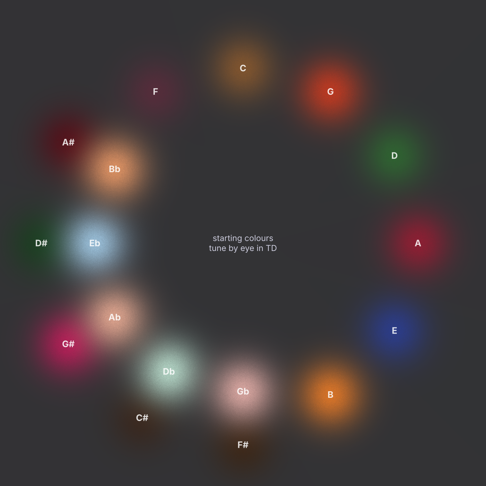

# td-live

A TouchDesigner rig for live solo guitar with visuals that listen: Michael Kramer's pitch–colour synesthesia, his
three-circle song-form notation, and charts that let the visuals know where the tune is going.

- `CONTEXT.md` — purpose, motives, roadmap, decisions (start here)
- `docs/NOTATION.md` — the three-circle notation and how it maps to chart files
- `synesthesia/palette.yaml` — the colour of every spelled pitch, in Michael's words
- `charts/` — the book (`schema/chart.schema.json`, one YAML file per tune)
- `tools/` — `chartlib.py` (shared logic), `check_book.py`, `render_palette.py`
- `tests/` — `python -m pytest tests`

Requires Python 3 with PyYAML (and optionally `jsonschema`, `matplotlib`, `numpy`) for the tools.
TouchDesigner project: `TDlive.toe` (includes the touchdesigner-mcp bridge).

